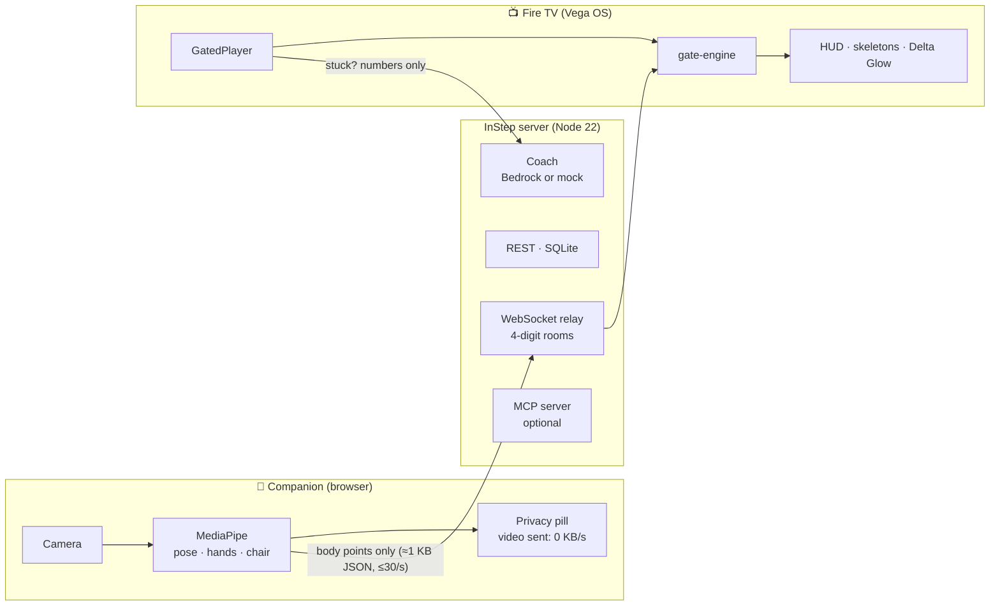

<div align="center">


# InStep

**The video that waits for you.**

How-to videos on Fire TV (Vega OS) that pause at each key moment and continue only when your pose,
hand shape, rhythm or hold is right — using the phone or laptop you already own as the camera.

[](https://github.com/LSUDOKO/InStep/actions/workflows/ci.yml)
[](LICENSE)


</div>

**Live:** [instep-wfcr.onrender.com/c](https://instep-wfcr.onrender.com/c/) — open it on a phone to use it as a camera
(free Render instance: the first request after idle takes about a minute to wake).

> Built for the **Build, Ship, Shape: Amazon Developer Hackathon** — Fire TV track, AWS Builder and Open Source
> mini challenges. Progress and honest limitations: [`docs/PROGRESS.md`](docs/PROGRESS.md) · friction with the
> tooling: [`docs/FRICTION_LOG.md`](docs/FRICTION_LOG.md).

---

## Why

Every how-to video has the same flaw: it doesn't wait for you. For people doing prescribed home exercises, parents
learning sign language for their deaf child, or anyone practising CPR, that means doing it wrong — or giving up.

- Falls are the second leading cause of unintentional injury death worldwide; an estimated 684,000 people die from
  falls each year ([WHO](https://www.who.int/news-room/fact-sheets/detail/falls)). The home-based Otago Exercise
  Programme reduced falls and fall injuries by 35% in controlled trials
  ([Texas A&M summary](https://ebc.tamhsc.edu/program/otago-exercise-program)).
- In a 2026 survey of 1,006 Americans, 76% did not complete all of their assigned at-home physical therapy
  exercises ([Medical Economics](https://www.medicaleconomics.com/view/patients-aren-t-doing-their-physical-therapy-homework)).
- At least 90% of deaf children are born to hearing parents
  ([summary](https://en.wikipedia.org/wiki/Language_acquisition_by_deaf_children)).

InStep is **designed to support** practice. It is not a medical device and has not been clinically tested.
Every number above is listed with its source in [`docs/SOURCES.md`](docs/SOURCES.md).

## How it works



1. The TV opens a lesson: a normal video plus an **`.istep`** sidecar file listing timed **gates**.
2. The phone joins by QR code. MediaPipe runs **in the phone's browser**; only normalised body points leave it.
3. At each gate the TV pauses. The shared **gate engine** checks every frame and resumes when you get it right.
4. Stuck for a few seconds? A kind coach gives one short tip (Amazon Bedrock, or templates in mock mode).

## Screenshots

All images below are real captures of the running app (Chrome with a test camera, real MediaPipe inference).
TV screenshots will be added once the Vega Virtual Device run is complete — the TV app is built and bundles in CI
but has not been launched on a device yet.

|                      Phone as camera                      |                               Live tracking + TV feedback                               |                          Privacy pill (measured)                          |
| :-------------------------------------------------------: | :-------------------------------------------------------------------------------------: | :-----------------------------------------------------------------------: |
|  |  |  |

|                    Creator Studio                    |                                      New lesson                                       |                       Recording (visible REC)                        |            Step editor with suggested steps             |
| :--------------------------------------------------: | :-----------------------------------------------------------------------------------: | :------------------------------------------------------------------: | :-----------------------------------------------------: |
|  |  |  |  |

<details>
<summary>Caregiver / physio report (share link, print-friendly, numbers only)</summary>


</details>

## Channels

| Channel                               | What the gates check                                                                                                      |
| ------------------------------------- | ------------------------------------------------------------------------------------------------------------------------- |
| **Fall Prevention** (hero)            | Chair safety check before balance work, posture holds, heel-raise reps, automatic sway stop, progression levels           |
| **Sign Language for Families** (hero) | Static ASL handshapes with finger-level **Delta Glow** feedback (no sound needed), fingerspelling sequence, Together mode |
| Stroke Hand Rehab                     | Quality reps (full range of motion only), pace-follow slows the video for a slow learner                                  |
| CPR Practice                          | Compression rhythm (100–120/min) and straight arms, metronome; **does not measure depth, not certification**              |
| Kids' Active Storytime                | Act out "The Forest Walk" with generous tolerances and a star burst on every pass                                         |

Safety notes shown in the app: exercises should be prescribed or approved by a physiotherapist; the CPR lesson is a
practice aid for rhythm and straight arms only; sign lessons are a practice aid — learn with Deaf teachers and
community too. The coach gives movement tips, never diagnoses.

## The `.istep` format

Like WebVTT for captions, `.istep` is an open JSON sidecar that attaches body-aware gates to any video.

```jsonc
{
  "istep": "1.0",
  "id": "asl-i-love-you-v1",
  "title": "Your first sign: I love you",
  "channel": "sign_language",
  "video": { "src": "video.mp4", "durationSec": 15 },
  "tracking": ["hands"],
  "gates": [
    {
      "id": "ily",
      "t": 7.5,
      "type": "hand_sign",
      "label": "Sign: I love you",
      "target": { "curl": [0, 0, 1, 1, 0], "spread": { "thumb_index": "open" } },
      "fallbackTip": "Fold your middle and ring fingers down; keep thumb, index and little finger up.",
    },
  ],
  // …camera placement, disclaimer, safety monitors, credits
}
```

Seven gate types: `pose_match`, `hold_duration`, `rep_count`, `rhythm_bpm`, `hand_sign`, `sequence_order`,
`safety_prerequisite`. Spec: [`docs/03-istep-format.md`](docs/03-istep-format.md) · JSON Schema:
[`packages/istep-format/schema/istep-1.0.schema.json`](packages/istep-format/schema/istep-1.0.schema.json).

```bash
pnpm --filter @instep/istep-format build
node packages/istep-format/bin/istep.mjs validate path/to/track.istep   # JSON-path errors on failure
```

## Privacy, measured

- Camera frames are processed only in the phone's browser and are never uploaded, recorded or relayed.
- The privacy pill counts every byte the page actually sends: `Video sent: 0.0 KB/s · Body points: x KB/s`.
- The server sends a strict Content-Security-Policy (`connect-src 'self'`) on the companion, so the browser blocks
  every third-party request — including MediaPipe's built-in usage telemetry, which has no opt-out.
- The relay never logs landmark payloads; rooms expire after 2 h idle. Reports and the MCP server expose aggregates
  only. The browser test asserts all of this on every push.

## Related work

InStep is **not** the first system where a video waits for the learner:

- [**Kemtai**](https://kemtai.com/) — computer-vision physiotherapy exercises with real-time corrective feedback.
- [**Fingerspelling.xyz**](https://fingerspelling.xyz/) — webcam ASL alphabet practice with machine learning.
- [**DRAX Inc., EP 4458432 A1**](https://patents.google.com/patent/EP4458432A1/en) — pausing or re-timing a workout
  guide video according to the user's posture.

What InStep adds: an **open `.istep` format** for _any_ video plus an **open-source Vega player**; **Creator
Studio** that turns one phone recording into a gated lesson automatically; **Fire TV / Vega OS** as the screen with
a phone as the camera; **one engine for five skill types** (poses, holds, reps, rhythm, hand shapes); **safety
first** (chair check, sway stop, fixed safety thresholds); **Together mode**; and **measured privacy**.

## Repository layout

```
packages/
  istep-format/   zod schema, JSON Schema, validator CLI, 7 example tracks
  gate-engine/    pure TypeScript gate engine + auto-gates (runs on TV, browser and Node)
  protocol/       WebSocket + REST message schemas
  gated-player/   platform-independent controller + <GatedPlayer/> for Vega (the OSS package)
apps/
  server/         Fastify + ws relay + SQLite + coach/voice/labels (Bedrock, Polly) + optional MCP
  companion/      Vite + React: camera node, Creator Studio, reports (served at /c/)
  tv/             Vega OS React Native app (installed with npm, like the official samples)
content/          demo lessons (track.istep, lesson.json, video.mp4 when recorded)
scripts/          dev cert, test TV, landmark replay, OSS export, kids video renderer
docs/             specification, progress and friction logs, submission kit, screenshots
```

## Quick start (fresh clone → running in under 15 minutes)

Requirements: Node ≥ 22.13, pnpm 11, ffmpeg (Creator Studio transcode), `mkcert` (phone camera needs HTTPS).

```bash
pnpm install
pnpm test                              # 239 tests across all packages
cp .env.example .env
pnpm cert                              # mkcert cert for your LAN IP; prints the .env lines to paste
pnpm companion:build                   # downloads MediaPipe models into /models and builds /c/
pnpm server                            # https://<LAN-IP>:8787 (phones) · http://<LAN-IP>:8788 (TV)
```

Then on a phone open `https://<LAN-IP>:8787/c/` (install the mkcert root CA first — `pnpm cert` tells you how).
Without a TV yet, `pnpm test-tv` prints a join QR code in the terminal and reports landmarks per second from each
connected phone.

The server listens twice: **HTTPS** for phones and laptops (camera access needs a secure context) and **plain
HTTP/WS** for the Vega TV app, so the TV never has to trust a self-signed certificate. Lessons in `content/lessons/`
are seeded on start; a lesson appears in the catalog only once its video exists.

### TV app (Vega Virtual Device)

```bash
cd apps/tv && npm install
npm run typecheck
npm run build:debug                       # react-native build-kepler (needs the Vega Developer Tools)
vega run-app build/*/*.vpkg com.instep.tv.main -d VirtualDevice
```

Default server for the VVD is `http://10.0.2.2:8788`; change it in **Settings → Server address** if your device
reaches the host differently. The TV app type-checks and Metro-bundles in CI; device verification is pending (see
`docs/PROGRESS.md`).

### Creator Studio

Open `https://<LAN-IP>:8787/c/creator`, enter the `CREATOR_PIN`, create a lesson, **record the demonstration**
(video + body points at 15 fps, visible REC indicator, max 60 s) or upload a video, review the suggested steps on the
timeline, try any step with your own camera, and publish — the lesson appears on every TV within seconds.

### Testing without a camera

Open the companion with `?room=1234&record=1`, do the movement, tap "Save landmarks recording" (a JSONL file of
numbers, saved on your device), then replay it into any TV room:

```bash
pnpm replay recording.jsonl --room <TV room> [--loop]
pnpm e2e                                 # Playwright: camera node, Creator Studio, report (fake camera)
```

## AI on AWS — how it is used, and what was verified

InStep uses two AWS services, both behind a single switch. `MOCK_AI=true` (the default, and what the hosted
instance runs) means **no AWS call is ever made**: tips come from templates built from the gate engine's own hint,
labels from templates, voice from the phone's browser.

| Service                                                                               | Used for                                                       | Guard rails in code                                                                                                                                                                                                                                                                                                                    |
| ------------------------------------------------------------------------------------- | -------------------------------------------------------------- | -------------------------------------------------------------------------------------------------------------------------------------------------------------------------------------------------------------------------------------------------------------------------------------------------------------------------------------- |
| **Amazon Bedrock — Converse API** (`apps/server/src/ai/bedrock.ts`, `coach/coach.ts`) | One short, kind coaching tip when a learner is stuck on a step | model id only from `BEDROCK_MODEL_ID`; system prompt forbids diagnosis, injury, medication and numbers; `maxTokens 80`, `temperature 0.4`, 4 s abort; output filtered (≤ 25 words, banned medical terms, no digits) or the lesson's `fallbackTip` is used; cached by `lesson\|gate\|errorBucket\|language`; 1 call per learner per 8 s |
| **Amazon Bedrock — Converse API** (`ai/labeler.ts`)                                   | Short labels and tips for the steps Creator Studio proposes    | strict JSON reply validated with zod; any failure keeps the deterministic template labels; each label passes the same safety filter                                                                                                                                                                                                    |
| **Amazon Polly — neural** (`ai/voice.ts`)                                             | Spoken version of a tip in en-US / es-ES / hi-IN / fr-FR       | voice map per language, MP3 cached on disk by text hash, falls back to browser speech on the phone                                                                                                                                                                                                                                     |
| **Shared daily budget** (`ai/budget.ts`)                                              | Every real call above                                          | `COACH_MAX_CALLS_PER_DAY` (default 300) across tips, labels and voice; counter in the logs                                                                                                                                                                                                                                             |

What leaves the server: for a tip, a JSON object of numbers and short strings (lesson, gate, which joint is off and
by roughly how much, attempt count, audience). Never video, images, landmark streams or names.

```bash
MOCK_AI=false
BEDROCK_MODEL_ID=amazon.nova-micro-v1:0     # any on-demand text model your account can call
AWS_REGION=us-east-1
POLLY_ENABLED=true
pnpm aws:check                              # free calls only: identity, model list, Polly voices
pnpm aws:check --probe --tts                # + one 5-token tip and one short synthesis
```

### Verified against a real AWS account (Oct 21, 2026)

`pnpm aws:check` (free control-plane calls only) against the developer's account: credentials valid, 49 on-demand
text models listed in us-east-1 including `amazon.nova-micro-v1:0`, and all four neural Polly voices available.

<p align="center"></p>

The first real Converse call hit the account's **daily Bedrock token allowance** (a small per-day cap on new
accounts, reset daily) — `ThrottlingException: Too many tokens per day`. That is exactly the case the coach is
built for: the server logs it and answers with the lesson's own fallback tip, and nothing is charged.

<p align="center"></p>

The hosted instance runs in mock mode. A real request to its coach endpoint answers in well under a second with the
template tip (first call `source: "mock"`, repeats `source: "cache"`), and `/api/health` reports `mockAi: true`:

<p align="center"></p>

The coach, labeler and safety filter have 18 unit tests (model errors, malformed JSON, the daily cap, banned
terms), plus 5 for the MCP server:

<p align="center"></p>

**Not yet shown:** a successful AI-written tip end to end. The account's daily quota was exhausted on the test day
and the project rule is to spend only existing credits; the probe will be re-run with `pnpm aws:check --probe`
once the quota resets. A budget alert should be set before switching `MOCK_AI` off: AWS console → Billing and Cost
Management → Budgets → Create budget → _Monthly cost budget_ → `$5` → your email.

### Hosting (Render)

The project is deployed at **https://instep-wfcr.onrender.com** from this repo's `Dockerfile` (Node 22 + ffmpeg,
MediaPipe models baked in): one web service serves the companion over HTTPS (so phone cameras work without
`mkcert`), the WebSocket relay, the REST API, lesson media and the MCP endpoint. Every push to `main` redeploys.

- Companion: `/c/` · Creator Studio: `/c/creator` · health: `/api/health` · MCP: `/mcp` (bearer token).
- Point the TV app at `https://instep-wfcr.onrender.com` in **Settings → Server address** (it connects over `wss://`).
- It runs on Render's free plan: no persistent disk (SQLite and uploaded lessons reset on each deploy) and the
  instance sleeps after 15 minutes idle. `render.yaml` documents the one-line change to a plan with a disk.
- `MOCK_AI` stays `true` there; no AWS credentials are configured on the hosted instance.

To host your own copy: Render → **New → Blueprint → this repo** (reads `render.yaml`, generates `CREATOR_PIN` and
`MCP_TOKEN`).

### MCP server (optional)

`MCP_ENABLED=true` exposes a read-only [Model Context Protocol](https://modelcontextprotocol.io) endpoint at
`/mcp` (Streamable HTTP) with two tools — `list_lessons` and `get_progress_report` — so a caregiver can ask their
AI assistant "Did Dad finish his balance exercises this week?". Aggregates only. On a hosted server set
`MCP_TOKEN`; clients must then send `Authorization: Bearer <token>`.

```json
{
  "mcpServers": {
    "instep": {
      "url": "https://<service>.onrender.com/mcp",
      "headers": { "Authorization": "Bearer <MCP_TOKEN>" }
    }
  }
}
```

## Open source package

**[github.com/LSUDOKO/vega-gated-video-player](https://github.com/LSUDOKO/vega-gated-video-player)** (MIT) is
the standalone package: the `.istep` format, the gate engine, the timing controller and `<GatedPlayer>` for Vega,
with a demo driven by a synthetic landmark stream. It is generated from this monorepo by
`node scripts/export-oss.mjs`, type-checks and passes its own 125 tests.

## Status

| Area                                                        | State                                                                                          |
| ----------------------------------------------------------- | ---------------------------------------------------------------------------------------------- |
| Packages (format, engine, protocol, player controller)      | ✅ built, tested (engine ≈ 98 % line coverage)                                                 |
| Server (relay, REST, coach, labels, voice, MCP)             | ✅ built, tested (60 s relay soak: 1800/1800 msgs, p95 1.2 ms)                                 |
| Companion (camera node, Creator Studio, report, hands-free) | ✅ built, Playwright e2e in CI                                                                 |
| TV app (Vega)                                               | 🟡 built, type-checks and Metro-bundles in CI — **not yet run on the Vega Virtual Device**     |
| Bedrock / Polly                                             | 🟡 code complete, runs in mock mode — not yet exercised against AWS                            |
| Lesson videos                                               | 🟡 kids lesson generated (original illustration); fall / sign / rehab / CPR recordings pending |

## Contributing

See [CONTRIBUTING.md](CONTRIBUTING.md), [SECURITY.md](SECURITY.md) and [AGENTS.md](AGENTS.md) (the honesty,
safety and privacy rules every change must keep).

## License

[MIT](LICENSE). Demo lesson content and consent records: [`content/CREDITS.md`](content/CREDITS.md).
