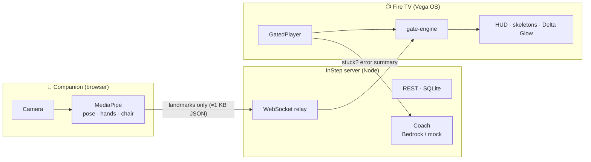

<div align="center">

# InStep

**The video that waits for you.**

How-to videos on Fire TV (Vega OS) that pause at each key moment and continue only when your pose,
hand shape, rhythm or hold is right — using a phone or laptop as the camera.

[](https://github.com/LSUDOKO/InStep/actions/workflows/ci.yml)
[](LICENSE)


</div>

> Built for the **Build, Ship, Shape: Amazon Developer Hackathon** — Fire TV track, AWS Builder and Open Source
> mini challenges. **Status: in active development** — see [`docs/PROGRESS.md`](docs/PROGRESS.md) for what works today.

---

## Why

Every how-to video has the same flaw: it doesn't wait for you. For people doing prescribed home exercises,
learning sign language for their child, or practising CPR, that means doing it wrong — or giving up.

- Falls are the second leading cause of unintentional injury death worldwide; an estimated 684,000 people die
  from falls each year ([WHO](https://www.who.int/news-room/fact-sheets/detail/falls)). The home-based Otago
  Exercise Programme reduced falls and fall injuries by 35% in controlled trials
  ([Texas A&M summary](https://ebc.tamhsc.edu/program/otago-exercise-program)).
- At least 90% of deaf children are born to hearing parents
  ([summary](https://en.wikipedia.org/wiki/Language_acquisition_by_deaf_children)).

InStep is **designed to support** practice. It is not a medical device and has not been clinically tested.

## How it works



1. The TV opens a lesson: a normal video plus an **`.istep`** sidecar file listing timed **gates**.
2. Your phone joins by QR code. MediaPipe runs **in the phone's browser**; only normalised body points are sent.
3. At each gate the TV pauses. The shared **gate engine** checks every frame and resumes when you get it right.
4. Stuck for a few seconds? A kind coach gives one short tip (Amazon Bedrock, or templates in mock mode).

**Privacy:** camera video never leaves the camera device. The companion shows a live, _measured_ counter:
`Video sent: 0 KB/s · Body points: x KB/s`.

## The `.istep` format

Like WebVTT for captions, `.istep` is an open JSON sidecar that attaches body-aware gates to any video.

```jsonc
{
  "istep": "1.0",
  "id": "asl-i-love-you-v1",
  "title": "Your first sign: I love you",
  "channel": "sign_language",
  "video": { "src": "video.mp4", "durationSec": 15 },
  "tracking": ["hands"],
  "gates": [
    {
      "id": "ily",
      "t": 7.5,
      "type": "hand_sign",
      "label": "Sign: I love you",
      "target": { "curl": [0, 0, 1, 1, 0], "spread": { "thumb_index": "open" } },
      "fallbackTip": "Fold your middle and ring fingers down; keep thumb, index and little finger up.",
    },
  ],
  // …camera, disclaimer, credits
}
```

Seven gate types: `pose_match`, `hold_duration`, `rep_count`, `rhythm_bpm`, `hand_sign`, `sequence_order`,
`safety_prerequisite`. Spec: [`docs/03-istep-format.md`](docs/03-istep-format.md) · JSON Schema:
[`packages/istep-format/schema/istep-1.0.schema.json`](packages/istep-format/schema/istep-1.0.schema.json).

```bash
pnpm --filter @instep/istep-format build
node packages/istep-format/bin/istep.mjs validate path/to/track.istep
```

## Channels

| Channel                        | What the gates check                                                         |
| ------------------------------ | ---------------------------------------------------------------------------- |
| **Fall Prevention**            | Chair safety check, posture holds, heel-raise reps, sway stop                |
| **Sign Language for Families** | Static ASL handshapes with finger-level "Delta Glow" feedback, Together mode |
| Stroke Hand Rehab              | Quality reps (full range of motion), pace-follow                             |
| CPR Practice                   | Compression rhythm (100–120/min) and straight arms                           |
| Kids' Active Storytime         | Fun poses with generous tolerances                                           |

Safety and honesty notes shown in the app: exercises should be prescribed or approved by a physiotherapist; the
CPR lesson is a practice aid for rhythm and straight arms only — it does not measure compression depth and is not
certification; sign lessons are a practice aid — learn with Deaf teachers and community too.

## Related work

InStep is **not** the first system where a video waits for the learner. Related work includes:

- **Kemtai** — camera-based physiotherapy exercises.
- **Fingerspelling.xyz** — webcam ASL alphabet feedback.
- **DRAX Inc. patent EP 4458432** — pausing workout videos until posture matches.

What InStep adds:

- An **open `.istep` format** that turns _any_ video into a gated lesson, plus an **open-source Vega player**.
- **Creator Studio**: an instructor records once on a phone and gates are placed automatically.
- **Fire TV / Vega OS** as the learning screen, with a phone as the camera.
- **One engine for five skill types**: poses, holds, reps, rhythm and hand shapes.
- **Safety first**: a chair safety check before balance work and an automatic sway stop.
- **Together mode**: two people must pass the gate, even from different homes.
- **Measured privacy**: the companion measures and shows 0 bytes of video sent.

## Repository layout

```
packages/
  istep-format/   zod schema, JSON Schema, validator CLI, example tracks
  gate-engine/    pure TypeScript gate engine (runs on TV, browser and Node)
  protocol/       WebSocket + REST message schemas
  gated-player/   <GatedPlayer/> React Native component (open-source package)
apps/
  server/         Fastify + ws relay + SQLite + coach/voice services
  companion/      Vite + React: camera node, Creator Studio, reports
  tv/             Vega OS React Native app
content/          demo lessons (video, .istep, reference landmarks)
docs/             specification, progress and friction logs
```

## Development

Requirements: Node ≥ 20, pnpm 11. The TV app additionally needs the
[Vega Developer Tools](https://developer.amazon.com/docs/vega/0.24/install-vega-sdk.html) (Ubuntu or macOS).

```bash
pnpm install
pnpm test          # vitest across all packages
pnpm lint && pnpm typecheck
```

### Run the server

```bash
cp .env.example .env
pnpm cert                # optional: mkcert HTTPS cert for your LAN IP (phones need HTTPS for the camera)
pnpm server              # https://<LAN-IP>:8787 (companion) · http://<LAN-IP>:8788 (TV)
```

The server listens twice: **HTTPS on `PORT`** for phones and laptops (camera access needs a secure context) and
**plain HTTP/WS on `TV_HTTP_PORT`** for the Vega TV app, so the TV never has to trust a self-signed certificate.
Lessons in `content/lessons/` are seeded on start; a lesson appears in the catalog only once its video is recorded.

### Companion (phone camera)

```bash
pnpm companion:build     # downloads MediaPipe models into /models and builds /c/
pnpm server              # then open https://<LAN-IP>:8787/c/ on your phone
pnpm test-tv             # terminal "TV": prints a join QR and reports landmarks per second
pnpm e2e                 # Playwright with Chrome's fake camera
```

### AI and cost safety

`MOCK_AI=true` is the default: coach tips come from templates and voice uses browser speech — no AWS calls.
Real Amazon Bedrock / Polly are used only with `MOCK_AI=false`; the model is read from `BEDROCK_MODEL_ID`.
Tips are cached and rate-limited (1 call / learner / 8 s, 300 / day).

**Set an AWS Budgets alert before turning AI on:** AWS console → Billing and Cost Management → Budgets →
Create budget → _Use a template: Monthly cost budget_ → amount `$5` → your email → Create.

## License

[MIT](LICENSE). Demo lesson videos are original recordings; see `content/CREDITS.md`.
